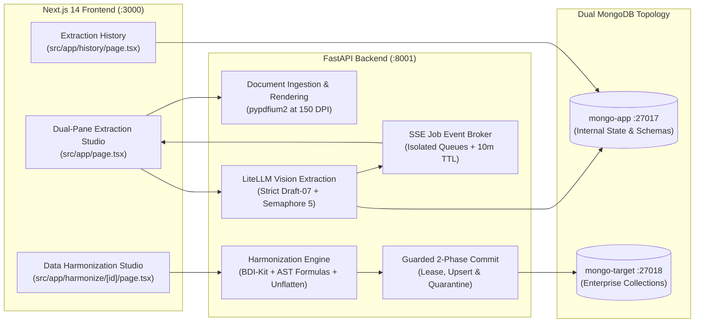

# Hamon: Document Extraction & Data Harmonization Platform

A commercial-grade full-stack platform for semi-automated document extraction, visual JSON Schema authoring, and enterprise data harmonization. Hamon converts multi-page PDFs and images into structured JSON records using Vision Language Models (VLMs) via LiteLLM, normalizes schemas to OpenAI strict structured output mode, executes AST-based data transformations, and commits harmonized BSON documents to enterprise MongoDB databases with transactional safety.

---

## 🏛️ System Architecture & Port Mapping



| Service | Port | Description |
| :--- | :--- | :--- |
| **Frontend** | `3000` | Next.js 14 LTS (React 18), Tailwind CSS, Lucide icons, `@retab` components |
| **Backend API** | `8001` | FastAPI, PyMongo native `AsyncMongoClient`, LiteLLM, BDI-Kit, `simpleeval` |
| **mongo-app** | `27017` | Application internal database (`extraction_app_db`) for schemas, documents, jobs, and profiles |
| **mongo-target** | `27018` | Simulated enterprise target database (`company_enterprise_db`) for committed records |

---

## ✨ Core Platform Capabilities

### 1. Document Ingestion & High-Resolution Rendering
- **Multi-Format Support**: Ingests PDFs, PNGs, JPEGs, WebP, and TIFF files.
- **Safety Guardrails**: Stream-validated 50 MB file limit (1 MB chunk buffer) and max 20 pages per document.
- **150 DPI Rendering**: Offloaded to worker threads with `pypdfium2`, running `doc.init_forms()` and `FPDFPage_Flatten` to preserve interactive form data and annotations.
- **Page Synchronization Barrier**: In-memory event notifier (`PageRenderNotifier`) allows extraction workers to safely await page rendering without race conditions.

### 2. Visual Schema Designer & Validation
- **Grounded Retab UI**: Embedded `@retab/schema-builder` supporting both visual tree editing and raw JSON Schema editing.
- **Strict Draft-07 Validation**: Validates all schemas against JSON Schema Draft-07 specifications on save and update.
- **Pre-Seeded Templates**: Pre-configured with *Commercial Invoice* and *Clinical / Lab Report* schemas.

### 3. VLM Vision Extraction & Concurrency Routing
- **OpenAI Strict Mode Normalizer**: Deepcopies schemas, strips metadata (`$schema`, `default`), wraps all properties in nullable `anyOf: [T, null]`, enforces `additionalProperties: False`, puts all properties in `required`, and rejects strict-incompatible constraints (`pattern`, `minimum`, etc.) with HTTP 400.
- **Adaptive Concurrency Routing**:
  - **$\le 3$ Pages**: Dispatched in a single multi-modal LiteLLM request containing all page images in one prompt (no merger overhead).
  - **$> 3$ Pages**: Throttled parallel page execution bounded by `asyncio.Semaphore(5)` with exponential backoff on HTTP 429 errors.
- **Schema-Guided Seam-Only Deduplication**: Concatenates multi-page arrays while only deduplicating identical records at page seams, preserving legitimate duplicates on the same page.
- **Accumulated Token Tracking**: Aggregates `prompt_tokens`, `completion_tokens`, and `total_tokens` across all document pages.

### 4. Real-Time SSE Progress Streaming
- **Isolated Subscriber Queues**: Multi-subscriber `JobEventBroker` streams granular state updates (`waiting_for_render` -> `extracting` -> `merging` -> `completed` / `partial_success` / `failed`).
- **Memory Safety**: 10-minute snapshot TTL with automatic cleanup.
- **Startup Sweeper**: Automatically marks mid-flight jobs from prior server crashes as `failed` on reboot.

### 5. Data Harmonization Engine & AST Formulas
- **Tabular Transformation**: Uses `pd.json_normalize` with automatic line-item extraction and scalar attribute enrichment.
- **Matching Methods**: LLM Semantic Matching (via LiteLLM), Token Heuristic (Jaccard similarity), and BDI-Kit Structural Matching (`similarity_flooding`, `jaccard_distance`).
- **Sandboxed AST Formula Evaluator**: Evaluates user formulas (e.g. `round(quantity * unit_price, 2)`) in a secure `simpleeval` sandbox. Strictly blocks dunder attributes (`__`) and expressions over 10,000 characters.
- **Hierarchical BSON Unflattening**: Converts dot notation (`financials.grand_total`) and bracketed array syntax (`items[0].sku`) into nested MongoDB subdocuments, sanitizing `NaN` and `None`.

### 6. Guarded 2-Phase Enterprise Commit
- **Phase 1 (Lease Acquisition)**: Acquires an atomic commit lease (`commit_in_progress = True`, status `"harmonizing"`), preventing duplicate commits.
- **Phase 2 (Commit / Upsert)**: Supports `append` or `upsert` by business key.
- **Null-Key Quarantine**: Automatically redirects records missing the business key into `{collection}_quarantine` with error annotations.
- **Compensating Rollback**: Automatically transitions job status to `"harmonize_failed"` on database error, releasing the lease safely.

---

## 🚀 Quickstart

### 1. Prerequisites
- **Docker Desktop** installed and running.
- **Node.js 20+ LTS** & **npm**.
- **Python 3.12+**.

### 2. Environment Configuration
Copy the example environment file and set your LLM API credentials:
```bash
cp .env.example .env
```
Default configuration values:
```env
APP_MONGODB_URI=mongodb://localhost:27017/extraction_app_db
TARGET_MONGODB_URI=mongodb://localhost:27018/company_enterprise_db
LLM_API_BASE=https://api.openai.com/v1
LLM_API_KEY=your_api_key_here
LLM_MODEL=openai/gpt-4o
BACKEND_PORT=8001
UPLOAD_DIR=./data/uploads
NEXT_PUBLIC_API_URL=http://localhost:8001/api
```

### 3. Option A: Full-Stack Docker Compose (Recommended)
Start all 4 services (`mongo-app`, `mongo-target`, `backend`, and `frontend`) in one command:
```bash
docker compose up -d --build
```
Verify container health:
```bash
docker compose ps
```
- **Web UI**: [http://localhost:3000](http://localhost:3000)
- **API Documentation**: [http://localhost:8001/docs](http://localhost:8001/docs)

### 4. Option B: Local Development
```bash
# 1. Start database containers
docker compose up -d mongo-app mongo-target

# 2. Setup Python backend virtual environment
python3.12 -m venv .venv
source .venv/bin/activate
pip install uv
uv pip install -r backend/requirements.txt

# 3. Setup Next.js frontend dependencies
npm install
cd frontend && npm install && cd ..

# 4. Start backend and frontend concurrently
npm run dev
```

---

## 📡 API Reference Overview

| Method | Endpoint | Description |
| :--- | :--- | :--- |
| `GET` | `/api/health` | Verifies server and individual MongoDB connection health |
| `POST` | `/api/schemas` | Creates a new Draft-07 JSON Schema definition |
| `GET` | `/api/schemas` | Lists all saved JSON schemas |
| `GET` | `/api/schemas/{id}` | Retrieves a schema definition by ID |
| `PUT` | `/api/schemas/{id}` | Updates an existing schema definition |
| `DELETE` | `/api/schemas/{id}` | Deletes a schema definition |
| `POST` | `/api/documents/upload` | Uploads a PDF or image and starts background 150 DPI rendering |
| `GET` | `/api/documents/{id}` | Retrieves document metadata and rendering status |
| `GET` | `/api/documents/{id}/file` | Streams original document binary |
| `GET` | `/api/documents/{id}/pages/{page}/render` | Serves rendered 150 DPI page PNG image |
| `POST` | `/api/extract/start` | Spawns background VLM extraction job |
| `GET` | `/api/extract/stream/{job_id}` | Real-time Server-Sent Events (SSE) status stream |
| `GET` | `/api/extract/status/{job_id}` | Fallback polling endpoint for extraction job status |
| `GET` | `/api/extract/jobs` | Lists historical extraction jobs sorted by date desc |
| `GET` | `/api/harmonize/target/collections` | Introspects available collections in enterprise MongoDB |
| `GET` | `/api/harmonize/methods` | Lists available schema matching algorithms |
| `POST` | `/api/harmonize/match-schema` | Proposes field mappings with confidence scores |
| `POST` | `/api/harmonize/match-values` | Generates categorical value dictionary alignments |
| `POST` | `/api/harmonize/preview` | Live 300ms debounced preview returning raw vs. harmonized diff |
| `GET` | `/api/harmonize/profiles` | Lists saved harmonization mapping profiles |
| `POST` | `/api/harmonize/profiles` | Saves or updates a harmonization mapping profile |
| `DELETE`| `/api/harmonize/profiles/{id}` | Deletes a saved harmonization profile |
| `POST` | `/api/harmonize/commit` | Guarded 2-Phase Commit with lease, upsert & quarantine |

---

## 🧪 Testing & Verification

### Run All Automated Tests
Runs backend unit & integration tests (`pytest`) followed by frontend production build validation (`next build`):
```bash
npm test
```

### Run Backend Tests Only
```bash
cd backend
pytest -v
```

### End-to-End Pipeline Smoke Test
Executes a 6-stage end-to-end smoke test verifying PDF rendering, schema normalization, multi-page seam deduplication, BDI normalization, AST formula transforms, and multi-tenant document materialization:
```bash
python3 scripts/test_pipeline.py
```

### Test API Health via CLI
```bash
curl -s http://localhost:8001/api/health | jq .
```
Expected response:
```json
{
  "status": "ok",
  "databases": {
    "app_db": true,
    "target_db": true
  }
}
```

---

## 🐳 Dev Container (VS Code)

1. Open this repository in **VS Code**.
2. When prompted (or via `Cmd + Shift + P` → `Dev Containers: Reopen in Container`), select reopen in container.
3. The unified container automatically joins the Docker network with `mongo-app` and `mongo-target`, sets up Python 3.12 + Node.js 20 LTS, and forwards all ports (`3000`, `8001`, `27017`, `27018`).

---

## 📚 External References & Grounding

External repository mirrors and documentation snapshots are managed via:
```bash
python3 scripts/sync_references.py
```
See [`.reference/INDEX.md`](.reference/INDEX.md) and [`docs/External References & Grounding Guide.md`](docs/External%20References%20&%20Grounding%20Guide.md) for local file trees and links.

---

## ⚖️ Legal Attribution & Commercial Licensing

All third-party libraries integrated into Hamon are licensed under commercial-friendly permissive licenses (MIT, Apache 2.0, BSD-3-Clause, ISC). Proprietary business logic, custom harmonization engines, and UI code remain 100% closed-source and proprietary.

See [`THIRD_PARTY_LICENSES.md`](THIRD_PARTY_LICENSES.md) for complete package inventories and copyright notices.
