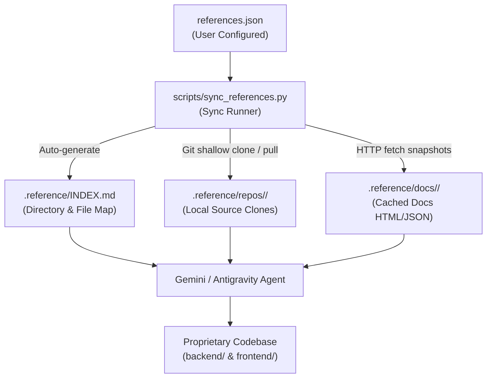

# External References & Grounding Guide

This guide explains how **Gemini / Antigravity** interacts with external codebases and documentation in this project, and how you can add, remove, or update references as the project evolves.

---

## 1. Overview & Architecture

Because AI assistants cannot natively browse private or external GitHub repositories without them being on disk, this workspace uses an **automated reference mirroring system**:



### Key Principles
- **No Git Pollution**: `.reference/` is strictly listed in `.gitignore`. External code is never committed to your proprietary Git repository.
- **Licensing Safety**: All linked repositories (`retab-ui`, `bdi-kit`) are verified under permissive open-source licenses (MIT, Apache-2.0).
- **100% Grounded**: Gemini inspects the real, exact source code and types rather than guessing or hallucinating implementations.

---

## 2. How Gemini Treats References

Gemini is governed by the persistent workspace rule [`.agents/rules/no-hallucinations.md`](file:///.agents/rules/no-hallucinations.md). This rule enforces the following behaviors without exception:

### 1. Mandatory Grounding Before Writing Integration Code
Before generating or modifying code that integrates with an external library (such as `@retab/schema-builder`, NYU VIDA's `bdi-kit`, or `litellm`):
1. Gemini inspects `references.json` and [`.reference/INDEX.md`](file:///.reference/INDEX.md).
2. Gemini uses file search tools (`grep_search`, `read_file`, `find_by_name`) inside `.reference/repos/<repo-name>/` to verify:
   - Exact exported symbols, function signatures, and classes.
   - TypeScript interfaces, props, and type definitions.
   - Python module layouts and valid parameter names.
3. Gemini consults `.reference/docs/<site-name>/` to follow official usage patterns, recommended configurations, and edge-case handling.

### 2. Strict Prohibition on Fabrications & Placeholders
- Gemini is **strictly forbidden** from writing dummy/mock implementations or vendoring unfamiliar libraries from memory.
- If a CLI package installation (e.g. `npx shadcn@latest add ...`) or Python import fails:
  - Gemini **stops** and diagnoses the error.
  - Gemini checks the real repository files in `.reference/repos/` to find the correct path or missing dependency.
  - Gemini fixes the configuration rather than writing a fake placeholder component to bypass the error.

### 3. Non-Interactive CLI Invocations
When installing shadcn registry components or running package managers, Gemini always passes non-interactive flags (`-y` / `--yes`) to ensure terminal sessions do not hang.

---

## 3. How to Update References

You have full control over which repositories and documentation sites Gemini can read.

### Step 1: Edit `references.json`
`references.json` is located at the root of the project:

```json
{
  "repositories": [
    {
      "name": "retab-ui",
      "url": "https://github.com/retab-dev/retab-ui.git",
      "branch": "main",
      "description": "Source for @retab/schema-builder and @retab/file-viewer shadcn registry components"
    },
    {
      "name": "bdi-kit",
      "url": "https://github.com/VIDA-NYU/bdi-kit.git",
      "branch": "devel",
      "description": "NYU VIDA BDI-Kit library for schema matching, value matching, and data harmonization"
    }
  ],
  "documentation_sites": [
    {
      "name": "bdi-kit-docs",
      "url": "https://bdi-kit.readthedocs.io/stable/",
      "key_pages": [
        "https://bdi-kit.readthedocs.io/stable/quick-start.html",
        "https://bdi-kit.readthedocs.io/stable/how-works.html",
        "https://bdi-kit.readthedocs.io/stable/schema-matching.html",
        "https://bdi-kit.readthedocs.io/stable/value-matching.html"
      ]
    }
  ]
}
```

#### Adding a Repository:
Add an object to the `"repositories"` array:
- `"name"`: Local directory name under `.reference/repos/`.
- `"url"`: Git clone URL (`https://github.com/user/repo.git`).
- `"branch"`: Branch or tag to checkout (defaults to `main` if omitted).
- `"description"`: Brief note on what the repository provides.

#### Adding Documentation:
Add an object to the `"documentation_sites"` array:
- `"name"`: Directory name under `.reference/docs/`.
- `"url"`: Main entry point or index page.
- `"key_pages"`: Specific subpages or JSON schema URLs to cache locally.

#### Removing a Reference:
Simply delete the corresponding entry from `references.json`.

---

### Step 2: Run the Sync Script
Run the automated sync script from your terminal:

```bash
python3 scripts/sync_references.py
```

*(Or simply tell Gemini: **"Sync my references"** and Gemini will run it for you.)*

#### What the script does automatically:
1. **Clones New Repositories**: Executes a shallow clone (`git clone --depth 1 --branch <branch>`) to minimize disk space and download time. If the branch does not exist, it falls back to the default branch.
2. **Updates Existing Repositories**: Runs `git -C .reference/repos/<name> pull --ff-only` to ensure local code matches the latest upstream changes.
3. **Prunes Removed Repositories**: Deletes any directory inside `.reference/repos/` that was removed from `references.json`, keeping your disk clean.
4. **Caches Documentation Pages**: Fetches HTML/JSON pages with a browser user-agent into `.reference/docs/<name>/`.
5. **Regenerates `.reference/INDEX.md`**: Builds a comprehensive markdown index containing the directory tree (top 2 levels) of all linked repositories and the list of cached documentation files.

---

## 4. Summary Table

| Action | Command / Location | What Happens |
| :--- | :--- | :--- |
| **Add a library/repo** | Edit `references.json` -> `"repositories"` | Declares new GitHub repo for Gemini to inspect |
| **Add doc URLs** | Edit `references.json` -> `"documentation_sites"` | Declares official docs/API specs to cache |
| **Sync / Pull updates** | `python3 scripts/sync_references.py` | Clones, updates, prunes, caches, and rebuilds `.reference/INDEX.md` |
| **Remove a library** | Remove from `references.json` and run sync | Directory is pruned from `.reference/repos/` and index is updated |
| **Inspect reference index** | [`.reference/INDEX.md`](file:///.reference/INDEX.md) | View all currently mirrored files and docs |
