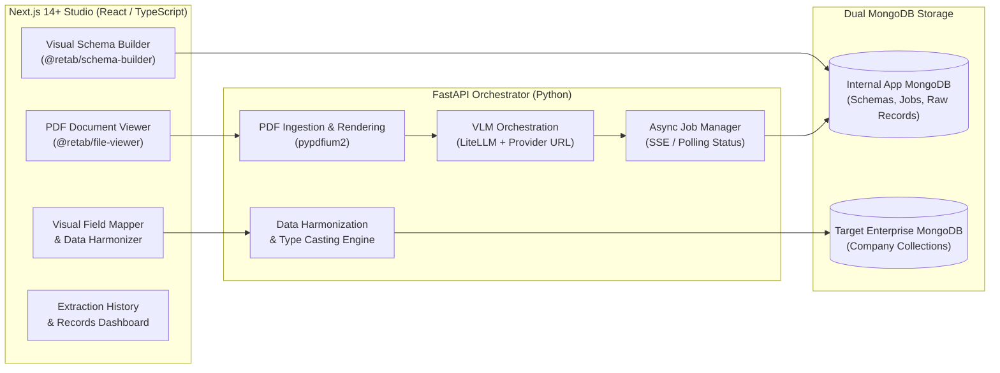
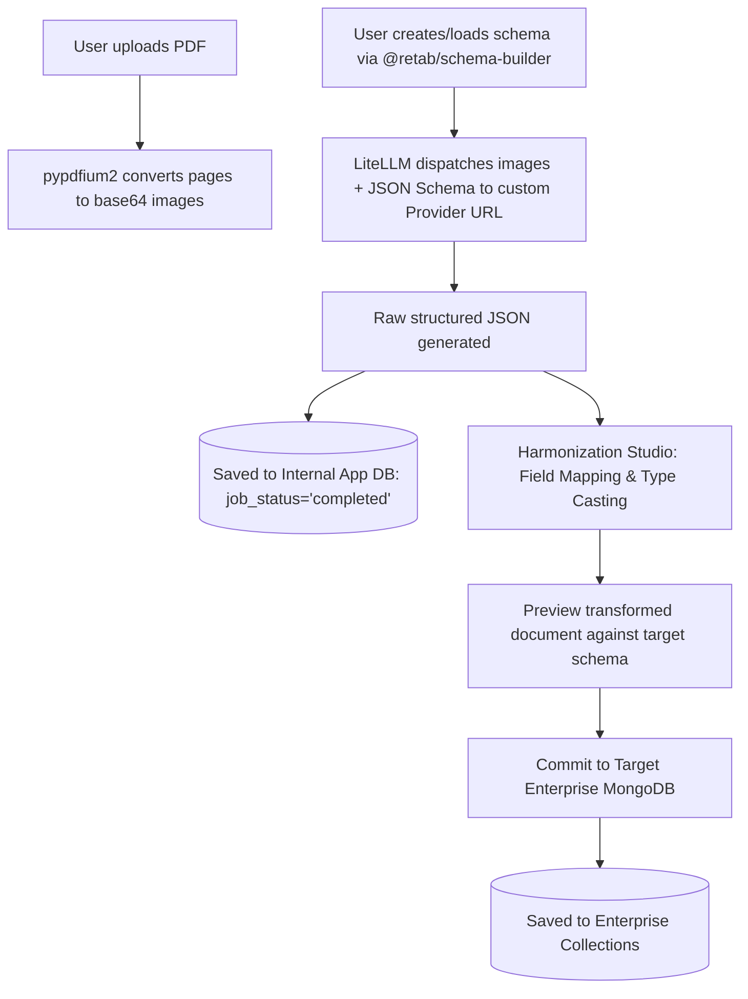

# Master Architecture Specification: PDF Extraction & Data Harmonization Platform

## 1. Executive Summary & Objective

This platform delivers an enterprise-grade document extraction and data harmonization pipeline designed for commercial, closed-source deployment. It provides a visual studio for extracting structured JSON from multi-page PDFs using Vision Language Models (VLMs) via custom LLM provider endpoints, visually mapping and transforming the extracted data, and safely committing records to an external enterprise MongoDB database.



---

## 2. Commercial Closed-Source Licensing & Legal Compliance

The final product will be sold with proprietary, closed-source licensing. The architecture strictly complies with all upstream licenses:

| Component / Dependency | License | Commercial Closed-Source Allowed? | Compliance Obligations |
| :--- | :--- | :--- | :--- |
| **`@retab/schema-builder` / `retab-ui`** | MIT | **Yes (100% Permissive)** | Retain copyright notice and MIT license text in bundled distribution. |
| **`litellm`** | MIT | **Yes (100% Permissive)** | Retain copyright notice and MIT license text in legal notices file. |
| **`pypdfium2` / `pdfium`** | Apache 2.0 / BSD | **Yes (100% Permissive)** | Include Apache 2.0 license & copyright notice. |
| **`FastAPI` / `Pydantic` / `Uvicorn`** | MIT | **Yes (100% Permissive)** | Retain standard MIT notices. |
| **`Next.js` / `React` / `Tailwind CSS`** | MIT | **Yes (100% Permissive)** | Retain standard MIT notices. |
| **`PyMongo` / `Motor`** | Apache 2.0 | **Yes (100% Permissive)** | Retain Apache 2.0 notice. |

> [!IMPORTANT]
> **No Viral / Copyleft Contamination:** Neither GPL, AGPL, nor SSPL is used in any application libraries or direct dependencies. All third-party libraries use permissive MIT, BSD, or Apache 2.0 licenses. Proprietary business logic, custom harmonization engines, and UI code remain 100% closed-source and proprietary. A `THIRD_PARTY_LICENSES.md` file is automatically generated to satisfy all attribution requirements.

---

## 3. High-Level System Architecture & Dual-DB Paradigm

The system isolates application operations from the customer's enterprise database using two independent MongoDB connections:

1. **Internal App Database (`APP_MONGODB_URI`)**:
   - Manages app configuration, saved JSON schema definitions, PDF document metadata, extraction job states, raw unharmonized JSON payloads, and saved harmonization mapping profiles.
2. **Target Enterprise Database (`TARGET_MONGODB_URI`)**:
   - The customer's pre-existing MongoDB instance containing company collections (e.g. `invoices`, `vendors`, `transactions`).
   - Configured strictly via environment variables. Credentials are never exposed to or edited via client-side UI.



---

## 4. Complete Project Directory Structure (Monorepo)

```
pdf-extraction-studio/
├── .env.example
├── .gitignore
├── README.md
├── THIRD_PARTY_LICENSES.md
├── docker-compose.yml
│
├── frontend/                     # Next.js 14+ (TypeScript, Tailwind, shadcn/ui)
│   ├── package.json
│   ├── tsconfig.json
│   ├── tailwind.config.ts
│   ├── components.json           # shadcn/ui configuration
│   ├── public/
│   │   └── uploads/              # Local static preview assets
│   ├── src/
│   │   ├── app/
│   │   │   ├── layout.tsx
│   │   │   ├── page.tsx          # Studio (Dual-pane workbench)
│   │   │   ├── history/
│   │   │   │   └── page.tsx      # Extraction history & records table
│   │   │   ├── harmonize/[id]/
│   │   │   │   └── page.tsx      # Visual Field Mapper & Harmonizer
│   │   │   └── api/              # Optional BFF proxy routes
│   │   ├── components/
│   │   │   ├── ui/               # shadcn/ui primitives (dialog, button, table, etc.)
│   │   │   ├── retab/
│   │   │   │   ├── schema-builder.tsx # Wrapped @retab/schema-builder
│   │   │   │   └── pdf-viewer.tsx     # Retab / PDF canvas previewer
│   │   │   ├── studio/
│   │   │   │   ├── studio-header.tsx
│   │   │   │   ├── schema-dialog.tsx  # Save / Load schema modal
│   │   │   │   ├── results-panel.tsx  # Raw JSON tree & table preview
│   │   │   │   └── job-progress.tsx   # SSE extraction status tracker
│   │   │   └── harmonizer/
│   │   │       ├── mapping-canvas.tsx # Field-to-field connection visualizer
│   │   │       ├── transform-config.tsx # Type casting & format selector
│   │   │       └── preview-diff.tsx   # Side-by-side JSON preview
│   │   └── lib/
│   │       ├── api-client.ts     # Type-safe client for FastAPI backend
│   │       ├── types.ts          # Shared TypeScript interfaces
│   │       └── utils.ts
│
├── backend/                      # FastAPI (Python 3.11+)
│   ├── requirements.txt
│   ├── pyproject.toml
│   ├── data/
│   │   └── uploads/              # Uploaded PDF binaries and page images
│   └── app/
│       ├── __init__.py
│       ├── main.py               # FastAPI entry point & CORS configuration
│       ├── config.py             # pydantic-settings (.env loader)
│       ├── database.py           # Dual MongoDB clients (App DB & Target DB)
│       ├── models/
│       │   ├── schema.py         # Pydantic schemas & MongoDB documents
│       │   ├── job.py            # Extraction job lifecycle models
│       │   └── harmonization.py  # Mapping rule definitions
│       ├── routers/
│       │   ├── documents.py      # PDF upload, page count, and image serving
│       │   ├── schemas.py        # Schema CRUD operations
│       │   ├── extract.py        # LiteLLM extraction trigger & SSE status
│       │   └── harmonize.py      # Target DB discovery, preview, & commit
│       └── services/
│           ├── pdf_service.py    # pypdfium2 PDF page-to-image converter
│           ├── litellm_service.py# LiteLLM multi-image prompt & structured output
│           └── mapper_service.py # Dynamic JSON transformation & type casting
```

---

## 5. Core Data Models & Schemas

### 5.1 Internal MongoDB Models

#### Collection: `schemas`
```json
{
  "_id": "ObjectId('...')",
  "name": "Commercial Invoice Extraction",
  "description": "Extracts line items, totals, tax IDs, and dates",
  "json_schema": {
    "type": "object",
    "properties": {
      "invoice_number": { "type": "string", "description": "Invoice reference ID" },
      "invoice_date": { "type": "string", "description": "Date of issue (YYYY-MM-DD)" },
      "vendor_name": { "type": "string" },
      "total_amount": { "type": "number" },
      "currency": { "type": "string" },
      "line_items": {
        "type": "array",
        "items": {
          "type": "object",
          "properties": {
            "description": { "type": "string" },
            "quantity": { "type": "number" },
            "unit_price": { "type": "number" },
            "amount": { "type": "number" }
          },
          "required": ["description", "amount"]
        }
      }
    },
    "required": ["invoice_number", "total_amount"]
  },
  "created_at": "2026-11-11T10:00:00Z",
  "updated_at": "2026-11-11T10:00:00Z"
}
```

#### Collection: `jobs`
```json
{
  "_id": "ObjectId('...')",
  "document_id": "uuid-v4",
  "filename": "supplier_bill_982.pdf",
  "schema_id": "ObjectId('...')",
  "status": "completed", // "pending" | "processing" | "completed" | "failed"
  "progress_percent": 100,
  "page_count": 2,
  "raw_extraction": { ... },
  "harmonized": false,
  "harmonized_target_collection": null,
  "created_at": "2026-11-11T10:05:00Z",
  "completed_at": "2026-11-11T10:05:18Z"
}
```

#### Collection: `harmonization_profiles`
```json
{
  "_id": "ObjectId('...')",
  "name": "Invoice -> Company ERP Ledger",
  "source_schema_id": "ObjectId('...')",
  "target_collection": "enterprise_invoices",
  "field_mappings": [
    {
      "source_path": "invoice_number",
      "target_field": "reference_id",
      "transform": "string"
    },
    {
      "source_path": "invoice_date",
      "target_field": "billing_date",
      "transform": "iso_date"
    },
    {
      "source_path": "total_amount",
      "target_field": "financials.grand_total",
      "transform": "float"
    }
  ]
}
```

---

## 6. Extraction & VLM Pipeline Contract

### 6.1 LiteLLM Dispatch Flow
FastAPI's `litellm_service.py` executes structured extraction as follows:
1. `pypdfium2` opens the uploaded PDF and renders each page as a high-resolution PNG (200-300 DPI).
2. Pages are encoded into base64 `data:image/png;base64,...` data URIs.
3. LiteLLM is called with:
   - `model`: e.g. `openai/gpt-4o` (or provider equivalent)
   - `api_base`: `settings.LLM_API_BASE`
   - `api_key`: `settings.LLM_API_KEY`
   - `messages`: Multi-modal message containing system prompt, instruction, and the array of image URLs representing all document pages.
   - `response_format`: `{"type": "json_schema", "json_schema": {"name": "document_extraction", "schema": schema_dict, "strict": True}}`
4. The validated JSON output is parsed, stored in the internal MongoDB job record, and sent to the client via SSE.

---

## 7. Data Harmonization Engine Specification

The harmonization engine operates on the extracted raw JSON:
- **Field Navigation:** Supports nested dot-paths (e.g. `items[].unit_price` or `metadata.vendor`).
- **Transform Operations:**
  - `string`: Casts value to trimmed string.
  - `int`: Converts numeric string or float to integer.
  - `float`: Converts currency/numeric strings into IEEE 754 floating point numbers.
  - `iso_date`: Parses arbitrary date formats (e.g. `MM/DD/YYYY`, `DD-Mon-YYYY`) into standard Python `datetime` / BSON `Date` objects.
  - `boolean`: Casts boolean flags.
  - `object_id`: Converts 24-character hexadecimal strings to MongoDB `ObjectId`.
  - `constant`: Injects fixed enterprise metadata (e.g., `source_system: "PDF_INGESTION_V1"`).
- **Execution Target:** When approved, the transformed document is inserted into `TARGET_MONGODB_URI` under the chosen collection using an atomic `insert_one` or `update_one(upsert=True)`.
