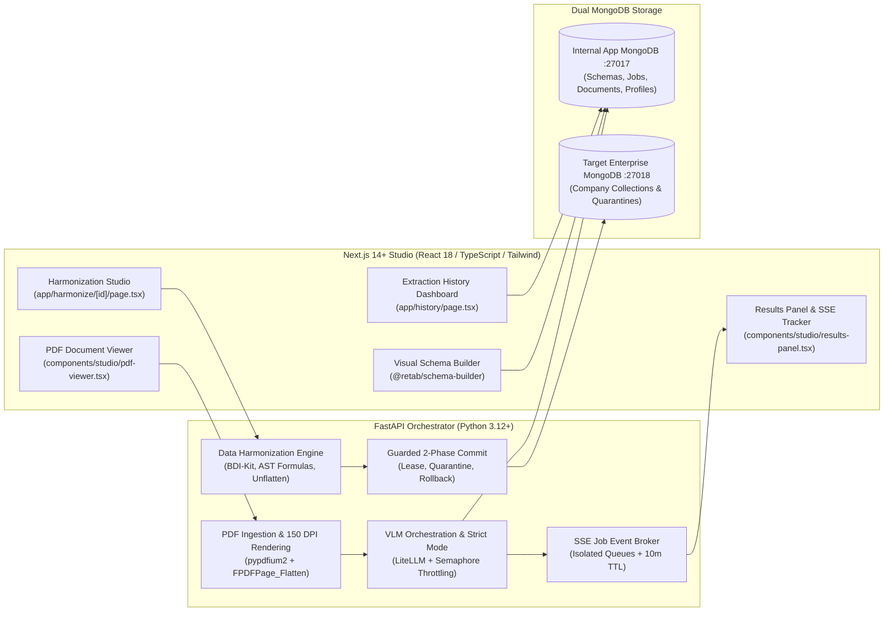
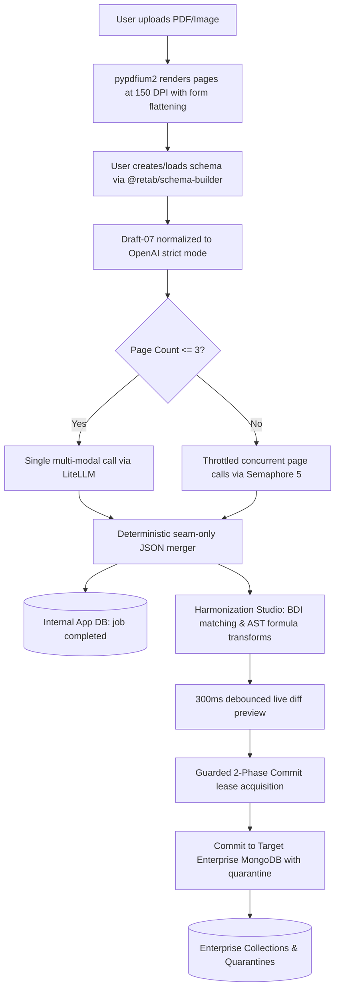
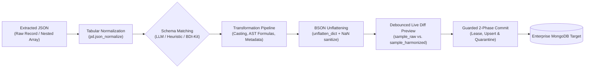

# Master Architecture Specification: PDF Extraction & Data Harmonization Platform

## 1. Executive Summary & Objective

This platform delivers an enterprise-grade document extraction and data harmonization pipeline designed for commercial, closed-source deployment. It provides a visual studio for extracting structured JSON from multi-page PDFs and images using Vision Language Models (VLMs) via custom LLM provider endpoints, visually mapping and transforming the extracted data, and safely committing records to an external enterprise MongoDB database.



---

## 2. Commercial Closed-Source Licensing & Legal Compliance

The final product will be sold with proprietary, closed-source licensing. The architecture strictly complies with all upstream licenses:

| Component / Dependency | License | Commercial Closed-Source Allowed? | Compliance Obligations |
| :--- | :--- | :--- | :--- |
| **`@retab/schema-builder` / `retab-ui`** | MIT | **Yes (100% Permissive)** | Retain copyright notice and MIT license text in bundled distribution. |
| **`litellm`** | MIT | **Yes (100% Permissive)** | Retain copyright notice and MIT license text in legal notices file. |
| **`pypdfium2` / `pdfium`** | Apache 2.0 / BSD | **Yes (100% Permissive)** | Include Apache 2.0 license & copyright notice. |
| **`FastAPI` / `Pydantic` / `Uvicorn`** | MIT / BSD | **Yes (100% Permissive)** | Retain standard MIT / BSD notices. |
| **`Next.js` / `React` / `Tailwind CSS`** | MIT | **Yes (100% Permissive)** | Retain standard MIT notices. |
| **`PyMongo`** | Apache 2.0 | **Yes (100% Permissive)** | Retain Apache 2.0 notice. |
| **`bdi-kit` (`bdikit`)** | Apache 2.0 | **Yes (100% Permissive)** | Retain Apache 2.0 notice & NYU copyright. |
| **`simpleeval`** | MIT | **Yes (100% Permissive)** | Retain standard MIT notices. |
| **`lift` (`datalab-to/lift`)** | Apache 2.0 (Code) | **Yes (100% Permissive)** | Code is Apache 2.0; use external API endpoints (LiteLLM/OpenAI) to avoid OpenRAIL-M model weights. |

> [!IMPORTANT]
> **No Viral / Copyleft Contamination:** Neither GPL, AGPL, nor SSPL is used in any application libraries or direct dependencies. All third-party libraries use permissive MIT, BSD, ISC, or Apache 2.0 licenses. Proprietary business logic, custom harmonization engines, and UI code remain 100% closed-source and proprietary. A `THIRD_PARTY_LICENSES.md` file is maintained to satisfy all attribution requirements.

---

## 3. High-Level System Architecture & Dual-DB Paradigm

The system strictly isolates application operations from the customer's enterprise database using two independent MongoDB connections:

1. **Internal Application Database (`APP_MONGODB_URI`)**:
   - Manages application configuration, JSON schema definitions, PDF document metadata, background rendering statuses, extraction job states, raw unharmonized JSON payloads, and saved harmonization mapping profiles.
   - Hosted by default on container port `27017` (`mongo-app` in Docker Compose).
2. **Target Enterprise Database (`TARGET_MONGODB_URI`)**:
   - The customer's pre-existing MongoDB instance containing enterprise company collections (e.g. `enterprise_invoices`, `vendors`, `transactions`).
   - Mapped to host port `27018` (container port `27017` in `mongo-target` for local simulation).
   - Configured strictly via environment variables. Credentials and connection strings are never exposed to or edited via client-side UI.



---

## 4. Complete Project Directory Structure (Monorepo)

```
Hamon/
├── .env.example
├── .env
├── .gitignore
├── README.md
├── references.json
├── package.json
├── THIRD_PARTY_LICENSES.md
├── docker-compose.yml
├── .devcontainer/
│   ├── devcontainer.json
│   ├── Dockerfile
│   └── docker-compose.yml
├── scripts/
│   ├── sync_references.py        # Automated GitHub repo & doc synchronizer
│   └── test_pipeline.py          # End-to-end smoke test script
├── docs/
│   ├── Master Architecture spec.md
│   ├── Step-by-step execution plan.md
│   ├── Phase 3 Architecture & Detailed Implementation Plan.md
│   └── External References & Grounding Guide.md
│
├── frontend/                     # Next.js 14 LTS (React 18, TypeScript, Tailwind CSS)
│   ├── Dockerfile
│   ├── package.json
│   ├── tsconfig.json
│   ├── tailwind.config.ts
│   ├── components.json           # shadcn/ui configuration
│   ├── public/
│   └── src/
│       ├── app/
│       │   ├── layout.tsx
│       │   ├── page.tsx          # Dual-Pane Extraction Studio Workbench
│       │   ├── history/
│       │   │   └── page.tsx      # Extraction History & Records Table
│       │   └── harmonize/[id]/
│       │       └── page.tsx      # Visual Field Mapper & Harmonizer Studio
│       ├── components/
│       │   ├── ui/               # shadcn/ui primitives (dialog, button, table, tabs, etc.)
│       │   ├── studio/
│       │   │   ├── pdf-viewer.tsx     # PDF viewer with page switcher & zoom
│       │   │   └── results-panel.tsx  # Live SSE progress & JSON/Table results view
│       │   ├── retab/
│       │   │   └── schema-editor-panel.tsx # Retab SchemaBuilder wrapper with toolbar
│       │   ├── schema-editor/    # Complete grounded @retab/schema-builder component tree
│       │   └── harmonizer/
│       │       ├── studio-header.tsx  # Target collection selector & commit trigger
│       │       ├── mapping-table.tsx  # Source-to-target field mapping & method selector
│       │       ├── formula-dialog.tsx # AST formula editor with live expression tester
│       │       └── live-preview-panel.tsx # Debounced side-by-side preview & diagnostics
│       ├── hooks/
│       │   ├── use-mounted.ts
│       │   └── use-mount-effect.ts
│       └── lib/
│           ├── api-client.ts     # Type-safe client for FastAPI backend
│           ├── types.ts          # Shared TypeScript interfaces
│           └── utils.ts
│
└── backend/                      # FastAPI (Python 3.12+)
    ├── Dockerfile
    ├── requirements.txt
    ├── pyproject.toml
    ├── data/
    │   └── uploads/              # Uploaded documents and rendered page images
    ├── tests/
    │   ├── test_health.py        # Health & database ping tests
    │   ├── test_schemas.py       # Schema CRUD & Draft-07 validation tests
    │   ├── test_schema_normalizer.py # OpenAI strict mode normalizer tests
    │   ├── test_json_merger.py   # Seam-only multi-page merger tests
    │   ├── test_unflatten.py     # Nested dot/bracket path unflattening tests
    │   ├── test_formula_evaluator.py # AST simpleeval formula tests
    │   └── test_bdi_harmonize.py # BDI-Kit schema matching & materialization tests
    └── app/
        ├── __init__.py
        ├── main.py               # FastAPI entry point, CORS & startup sweeper
        ├── config.py             # pydantic-settings configuration loader
        ├── database.py           # Dual PyMongo AsyncMongoClient & seed templates
        ├── models/
        │   ├── schema.py         # Schema CRUD models & Draft-07 validators
        │   ├── document.py       # DocumentMetadata & DocumentResponse models
        │   ├── job.py            # ExtractionJob, TokenUsage & lifecycle models
        │   └── harmonization.py  # FieldMappingItem, HarmonizationProfile & commit models
        ├── routers/
        │   ├── schemas.py        # Schema CRUD endpoints (/api/schemas)
        │   ├── documents.py      # Document upload & page rendering (/api/documents)
        │   ├── extract.py        # LiteLLM extraction & SSE stream (/api/extract)
        │   └── harmonize.py      # BDI matching, preview & 2-phase commit (/api/harmonize)
        └── services/
            ├── pdf_service.py    # pypdfium2 150 DPI rasterizer & page barrier notifier
            ├── litellm_service.py# Strict schema normalizer & LiteLLM VLM orchestrator
            ├── bdi_service.py    # Schema/value matching, transform runner & materializer
            ├── formula_evaluator.py # Sandboxed simpleeval AST formula executor
            └── unflatten_utils.py   # Dot-path & bracket unflattening with BSON sanitization
```

---

## 5. Core Data Models & Schemas

### 5.1 Internal Application Models (`APP_MONGODB_URI`)

#### Collection: `schemas`
Manages user-defined and system-seeded Draft-07 JSON Schema templates.
```json
{
  "_id": "ObjectId('67320b92e73f2a8910a301a1')",
  "name": "Commercial Invoice",
  "description": "Extracts line items, totals, tax IDs, and dates",
  "json_schema": {
    "$schema": "http://json-schema.org/draft-07/schema#",
    "type": "object",
    "properties": {
      "invoice_number": { "type": "string", "description": "Invoice reference ID" },
      "invoice_date": { "type": "string", "description": "Date of issue (YYYY-MM-DD)" },
      "vendor_name": { "type": "string" },
      "total_amount": { "type": "number" },
      "currency": { "type": "string" },
      "line_items": {
        "type": "array",
        "items": {
          "type": "object",
          "properties": {
            "description": { "type": "string" },
            "quantity": { "type": "number" },
            "unit_price": { "type": "number" },
            "amount": { "type": "number" }
          },
          "required": ["description", "amount"]
        }
      }
    },
    "required": ["invoice_number", "total_amount"]
  },
  "created_at": "2026-11-11T10:00:00Z",
  "updated_at": "2026-11-11T10:00:00Z"
}
```

#### Collection: `documents`
Tracks ingested document binaries and their asynchronously rendered 150 DPI page images.
```json
{
  "_id": "67320bc0e73f2a8910a301a2",
  "filename": "supplier_bill_982.pdf",
  "content_type": "application/pdf",
  "file_size": 245760,
  "file_path": "./data/uploads/67320bc0e73f2a8910a301a2/document.pdf",
  "page_count": 2,
  "rendered_pages": [0, 1],
  "render_status": "completed",
  "error_message": null,
  "tenant_id": "default_tenant",
  "created_at": "2026-11-11T10:05:00Z",
  "updated_at": "2026-11-11T10:05:02Z"
}
```

#### Collection: `jobs`
Tracks vision extraction executions, token usage, and harmonization statuses.
```json
{
  "_id": "67320be1e73f2a8910a301a3",
  "document_id": "67320bc0e73f2a8910a301a2",
  "filename": "supplier_bill_982.pdf",
  "schema_id": "67320b92e73f2a8910a301a1",
  "json_schema": { ... },
  "page_range": "0-1",
  "requested_pages": [0, 1],
  "status": "completed",
  "progress_percent": 100,
  "raw_extraction": {
    "invoice_number": "INV-98214",
    "invoice_date": "2025-05-14",
    "vendor_name": "Acme Industrial Supplies",
    "total_amount": 1420.50,
    "currency": "USD",
    "line_items": [
      {
        "description": "High Precision Bearings",
        "quantity": 10,
        "unit_price": 95.0,
        "amount": 950.0
      },
      {
        "description": "Hydraulic Sealant",
        "quantity": 5,
        "unit_price": 94.1,
        "amount": 470.5
      }
    ]
  },
  "token_usage": {
    "prompt_tokens": 1280,
    "completion_tokens": 310,
    "total_tokens": 1590
  },
  "failed_pages": [],
  "harmonized": true,
  "harmonized_target_collection": "enterprise_invoices",
  "commit_in_progress": false,
  "tenant_id": "default_tenant",
  "created_at": "2026-11-11T10:05:05Z",
  "updated_at": "2026-11-11T10:05:25Z",
  "completed_at": "2026-11-11T10:05:20Z"
}
```

#### Collection: `harmonization_profiles`
Persists reusable field mapping rules, formula expressions, and target collection bindings.
```json
{
  "_id": "67320c15e73f2a8910a301a4",
  "name": "Invoice -> Company ERP Ledger",
  "source_schema_id": "67320b92e73f2a8910a301a1",
  "target_collection": "enterprise_invoices",
  "tenant_id": "default_tenant",
  "field_mappings": [
    {
      "source_path": "invoice_number",
      "target_field": "reference_id",
      "transform": "string",
      "transform_args": null
    },
    {
      "source_path": "invoice_date",
      "target_field": "billing_date",
      "transform": "iso_date",
      "transform_args": null
    },
    {
      "source_path": "total_amount",
      "target_field": "financials.grand_total",
      "transform": "clean_currency",
      "transform_args": null
    },
    {
      "source_path": "",
      "target_field": "financials.tax_computed",
      "transform": "formula",
      "transform_args": { "expression": "round(total_amount * 0.20, 2)" }
    },
    {
      "source_path": "",
      "target_field": "source_system",
      "transform": "constant",
      "transform_args": { "value": "HAMON_V1" }
    }
  ],
  "created_at": "2026-11-11T10:10:00Z",
  "updated_at": "2026-11-11T10:10:00Z"
}
```

---

## 6. Extraction & VLM Pipeline Contract (Lift + LiteLLM)

The extraction pipeline integrates open-source engineering primitives from `lift` and `pypdfium2` while remaining completely decoupled from proprietary model weights or local inference runtimes (`torch`, `transformers`, `accelerate`). All generation is dispatched asynchronously via `LiteLLM` to the configured LLM API endpoint.

### 6.1 Lift Utility Integration & PDF Rendering
- **Document Preprocessing (`pypdfium2` + `pdfium_c`)**:
  - Ingestion limits: max 50 MB (stream-validated in 1MB chunks) and max 20 pages per document.
  - Page-by-page rendering offloaded to worker threads via `asyncio.to_thread(_render_page_to_disk_sync)`.
  - Form field preservation: `doc.init_forms()` is called prior to flattening.
  - Interactive form and annotation flattening via `pdfium_c.FPDFPage_Flatten(page, pdfium_c.FLAT_NORMALDISPLAY)`.
  - Renders at 150 DPI with automatic downscaling for oversized dimensions (>3000px).
  - Atomic temporary file writes (`page_{i}.png.tmp` renamed to `page_{i}.png`).
  - In-memory pub/sub barrier (`PageRenderNotifier`) allows extraction jobs to safely await page readiness without race conditions.
- **Vision Preprocessing (`lift.model.util`)**:
  - `scale_to_fit(img, max_size=(1088, 1408), grid_size=28)` resamples pages on 28px patch boundaries to prevent vision token explosions.
  - `detect_repeat_token()` detects degenerative model generation loops and triggers retry logic.
- **Prompt Scaffolding (`lift.prompts`)**:
  - Employs `DIRECT_EXTRACTION_PROMPT` for zero-shot schema extraction.

### 6.2 OpenAI Strict Schema Normalizer
OpenAI structured output strict mode enforces rigid grammar constraints. `normalize_schema_for_strict_mode()` prepares any valid Draft-07 schema:
1. Validates standard Draft-07 compliance via `jsonschema.Draft7Validator.check_schema`.
2. Inspects for and rejects strict-incompatible keywords (`pattern`, `minimum`, `maximum`, `minLength`, `maxLength`, `minItems`, `maxItems`, `uniqueItems`, `multipleOf`) with HTTP 400.
3. Performs deepcopy isolation to ensure the user's stored Draft-07 schema is never mutated in-place.
4. Unpacks composite type arrays (e.g. `type: ["string", "null"]` -> scalar `type: "string"`).
5. Strips unsupported keywords (`$schema`, `id`, `$id`, `default`).
6. Preserves semantic hints by converting `"format"` into a description annotation (e.g. `description: "Date of issue (Format: date)"`).
7. Enforces strict object compliance:
   - Sets `"additionalProperties": False` on every object node.
   - Places every defined property key into `"required"`.
   - Wraps every property into a nullable union: `{"anyOf": [original_type, {"type": "null"}]}`.

### 6.3 3-Page Threshold Concurrency Engine
- **Documents $\le 3$ Pages**:
  - Dispatched as a single multi-modal request attaching all page image data URIs in one prompt.
  - Returns complete extracted JSON directly without needing multi-page merge logic.
  - Temperature starts at `0.0`. Loop detection or JSON decode errors trigger retry with `temperature=0.3`.
- **Documents $> 3$ Pages**:
  - Document pages are processed concurrently, throttled by `asyncio.Semaphore(5)` to prevent provider rate limits.
  - Each page receives an explicit single-page prompt: *"Extract ONLY fields visible on this page. Return null for fields not present and [] for empty lists."*
  - Automatically retries transient errors (HTTP 429, timeouts) up to 3 times with exponential backoff.
  - Safely accumulates token usage (`prompt_tokens`, `completion_tokens`, `total_tokens`) across all pages.
- **Deterministic Schema-Guided JSON Merger**:
  - Resolves property types using the original Draft-07 user schema plus runtime `isinstance` checks.
  - **Seam-Only Deduplication**: Deduplicates array items across page seams (comparing the last item of page $k$ with the first item of page $k+1$), preserving legitimate identical rows on the same page.
  - **Scalar Prioritization**: Retains the first valid scalar value while strictly preserving `0`, `0.0`, and `False` (ignoring empty strings and containers).
  - **Recursive Object Merging**: Null-coalesces nested structures.
- **Resilient Partial Aggregation**:
  - If a page fails after all retries, its index is recorded in `failed_pages`.
  - If $0 < \text{failed} < \text{total}$, the job succeeds partially with status `"partial_success"` and returns data extracted from successful pages.
  - If all pages fail, status is set to `"failed"`.

### 6.4 Real-Time SSE Stream & Startup Sweeper
- **Job Event Broker (`JobEventBroker`)**:
  - Multi-subscriber pub/sub broker providing isolated `asyncio.Queue` instances per client connection.
  - Safely copies subscriber queues prior to iteration to prevent concurrent modification errors.
  - Caches latest job snapshots with an automatic 10-minute TTL cleanup to support client reconnects without memory leaks.
- **Startup Sweeper**:
  - On backend startup, automatically transitions any abandoned in-flight jobs (`pending`, `waiting_for_render`, `extracting`, `merging`, `harmonizing`) from prior crashes to status `"failed"` with clear error diagnostic notes.

---

## 7. Data Harmonization Engine Specification

The harmonization engine transforms extracted JSON records into enterprise-ready BSON documents:



### 7.1 Tabular Extraction & Normalization
- Converts raw extracted JSON into a Pandas DataFrame using `pd.json_normalize`.
- If `root_array_path` is specified (e.g. `line_items`), extracts nested line items into individual rows while enriching each row with top-level scalar document attributes (e.g. `invoice_number`, `vendor_name`).

### 7.2 Schema & Value Matching Strategies
Supported matching methods accessible via `GET /api/harmonize/methods` and `POST /api/harmonize/match-schema`:
1. **`llm` (Default Semantic Matcher)**: Prompts LiteLLM with source fields, target collection fields, and sample values to semantically deduce alignments and suggest type transforms.
2. **`heuristic` (Token Jaccard / Levenshtein)**: Fast token-based string similarity matching with naming heuristics (e.g. fields containing `date` map to `iso_date`; `amount`/`price` map to `clean_currency`).
3. **`similarity_flooding` (BDI-Kit)**: Graph-based structural alignment algorithm from `bdikit`.
4. **`jaccard_distance` (BDI-Kit)**: N-gram and token set distance matching from `bdikit`.
5. **Value Matching (`POST /api/harmonize/match-values`)**: Proposes categorical value dictionaries (`bdikit.match_values` or exact token fallback).

### 7.3 Transformation Pipeline & AST Formula Engine
`materialize_and_cast()` applies transformation operations defined in `FieldMappingItem`:
- `direct`: Retains original value as-is.
- `trim`: Casts to string and strips leading/trailing whitespace.
- `string`: Converts value to string.
- `int`: Sanitizes currency/commas and casts to integer.
- `float` / `clean_currency`: Cleans currency strings (e.g. `"$1,234.50"`, `"(50.00)"`) to IEEE 754 floats.
- `iso_date`: Parses various date formats (`YYYY-MM-DD`, `MM/DD/YYYY`, `DD-Mon-YYYY`) into standard `YYYY-MM-DD` strings.
- `boolean`: Casts boolean representations (`"true"`, `"yes"`, `"1"` -> `True`).
- `object_id`: Converts 24-character hex strings into BSON `ObjectId`.
- `constant`: Injects fixed metadata (e.g. `source_system: "HAMON_V1"`).
- `formula`: Executes sandboxed AST expressions using `simpleeval`.
  - **Security Guardrails**: Rejects expressions >10,000 characters; strictly forbids dunder attributes (`__`).
  - **Safe Function Whitelist**: `clean_currency`, `to_date`, `round`, `abs`, `min`, `max`, `len`, `str`, `int`, `float`, `upper`, `lower`, `strip`, `re_sub`, `str_slice`.

### 7.4 BSON Unflattening & Path Resolution
`unflatten_dict()` reconstructs hierarchical BSON documents from flat mapping targets:
- Supports dotted object notation: `"financials.grand_total"` -> `{"financials": {"grand_total": ...}}`.
- Supports bracketed and numeric array notation: `"line_items[0].qty"` or `"items.0.sku"` -> `{"line_items": [{"qty": ...}]}`.
- Sanitizes incompatible values (`NaN`, `inf`, `pd.NA`) to `None` for BSON serialization.
- Enforces multi-tenant logical isolation by injecting `tenant_id`.

### 7.5 Guarded 2-Phase Commit & Compensating Rollback
`POST /api/harmonize/commit` implements enterprise data safety:
1. **Phase 1: Lease Acquisition**:
   - Atomically updates `app_db.jobs` where `commit_in_progress != True`, setting `commit_in_progress = True` and `status = "harmonizing"`.
   - Prevents double-commit race conditions (returns HTTP 409 Conflict if already in flight).
2. **Phase 2: Database Operation**:
   - **Append Mode**: Inserts records directly via `insert_many`.
   - **Upsert Mode**: Updates records matching `business_key` + `tenant_id` (`update_one(..., upsert=True)`).
   - **Null-Key Quarantine**: Records with a missing or null business key are routed to `{target_collection}_quarantine` with `_quarantine_reason` and `_quarantined_at` annotations.
3. **Completion or Rollback**:
   - On success: marks job `harmonized = True`, `harmonized_target_collection = target_collection`, releases lease.
   - On exception: executes compensating rollback setting status `"harmonize_failed"`, records diagnostic error, and releases lease.

---

## 8. Frontend Architecture & User Experience

Built on Next.js 14 LTS with Tailwind CSS and shadcn/ui primitives.

```
frontend/src/
├── app/
│   ├── page.tsx               # Studio Workbench: Dual-pane layout
│   ├── history/page.tsx       # Extraction History: Job auditing & metrics
│   └── harmonize/[id]/page.tsx# Harmonization Studio: Field mapping & preview
```

### 8.1 Dual-Pane Extraction Studio (`/`)
- **Top Action Bar**: Document uploader, active schema template badge, backend health indicator, and "Run Extraction" button.
- **Left Pane (`PdfViewer`)**:
  - Drag-and-drop document upload (`POST /api/documents/upload`).
  - Renders 150 DPI page images served from `GET /api/documents/{doc_id}/pages/{page_number}/render`.
  - Interactive page navigation, thumbnail ribbon, and zoom controls.
- **Right Pane**:
  - **Schema Editor Tab (`SchemaEditorPanel`)**: Visual schema designer wrapped around `@retab/schema-builder` with visual fields view, raw JSON schema view, template selector, and save/update modal.
  - **Results Tab (`ResultsPanel`)**: Live SSE progress bar, raw JSON tree explorer, tabular record viewer, and a direct navigation button: `"Harmonize with BDI-Kit →"`.

### 8.2 Extraction History Dashboard (`/history`)
- Audits all historical extraction jobs from `GET /api/extract/jobs`.
- Displays Document Name, Schema Name, Creation Timestamp, Page Counts, Extraction Status badge, Token Usage, and Harmonization Status.
- Actions: "Inspect JSON" modal dialog and "Open in Harmonizer" navigation button.

### 8.3 Data Harmonization Studio (`/harmonize/[id]`)
- **Studio Header (`StudioHeader`)**: Document metadata, target enterprise collection selector, and primary "Commit to Enterprise MongoDB" action.
- **Field Mapping Table (`MappingTable`)**:
  - Source-to-target field mapping rows.
  - Schema matching method picker (`LLM Semantic`, `Token Heuristic`, `Similarity Flooding`, `Jaccard Distance`).
  - Similarity confidence score badges.
  - Transform selector (`direct`, `trim`, `string`, `int`, `float`, `clean_currency`, `iso_date`, `boolean`, `object_id`, `constant`, `formula`).
  - Custom Formula Dialog (`FormulaDialog`) with syntax highlighting, variable chips, and live preview evaluator.
- **Live Preview Panel (`LivePreviewPanel`)**:
  - 300ms debounced live preview (`POST /api/harmonize/preview`).
  - Side-by-side view: sample extracted raw row vs. harmonized BSON document.
  - Paginated preview of the first 10 harmonized records.
  - Transformation diagnostic callouts for casting warnings.

---

## 9. Docker Deployment & Orchestration

The platform provides a complete four-container Docker Compose stack in `docker-compose.yml`:

| Container | Service Name | Image / Build | Port | Role |
| :--- | :--- | :--- | :--- | :--- |
| **`hamon-mongo-app`** | `mongo-app` | `mongo:7` | `27017:27017` | Application internal database (`extraction_app_db`) |
| **`hamon-mongo-target`** | `mongo-target` | `mongo:7` | `27018:27017` | Enterprise target database (`company_enterprise_db`) |
| **`hamon-backend`** | `backend` | `./backend/Dockerfile` | `8001:8001` | FastAPI orchestrator & LiteLLM / BDI-Kit engine |
| **`hamon-frontend`** | `frontend` | `./frontend/Dockerfile` | `3000:3000` | Next.js 14 production web studio |
