# Phase 3 Architecture Review & Detailed Execution Specification

This document provides the definitive, production-grade technical specification for **Phase 3: Lift-Powered Document Preprocessing & LiteLLM Vision Extraction Pipeline**, incorporating all audited architectural fixes and user-selected design choices: robust Draft-07 schema normalization for OpenAI strict mode, uniform MongoDB `ObjectId` identifiers, async orchestrator rendering with PDFium form initialization and page-level barriers, multi-subscriber SSE event broadcasting with TTL cleanup, bounded concurrency, resilient partial aggregation, seam-only array deduplication, and null-safe deterministic merging.

---

## 1. Executive Summary & Core Objectives

Phase 3 builds the core document intelligence engine for Hamon. It receives multi-page PDFs and images, renders and serves crisp page images incrementally, normalizes user-defined Draft-07 JSON schemas for OpenAI strict structured outputs, executes multi-modal vision extraction through LiteLLM asynchronously, and streams real-time progress events to client interfaces.

### Key Architectural Tenets (Audited & Aligned):
1. **Lift Primitives Reusability & Standards-Compliant Validation**:
   - Reuse document ingestion, annotation flattening (`pdfium_c.FPDFPage_Flatten`), aspect-ratio vision scaling (`scale_to_fit`), loop detection (`detect_repeat_token`), and prompt templates (`DIRECT_EXTRACTION_PROMPT`) from `lift` / `pypdfium2`.
   - Strict pip dependency: Add `lift-pdf>=0.1.2` directly in `backend/requirements.txt` and `backend/pyproject.toml` (without `[hf]`). Application code fails fast with `ImportError` if not installed in virtual environment.
   - For schema validation: use specification-compliant `jsonschema.Draft7Validator.check_schema(schema)` (avoiding dynamic Pydantic class generation).
2. **Model Independence & Pure LiteLLM**: Strictly decouple from Datalab's local OpenRAIL-M model weights and heavyweight machine learning dependencies (`torch`, `transformers`, `accelerate`). All generation is dispatched asynchronously via `litellm.acompletion` targeting our OpenAI-compatible endpoint (`LLM_API_BASE`, `LLM_API_KEY`, `LLM_MODEL`).
3. **OpenAI Strict Structured Outputs & Schema Lifecycle**:
   - Store the original user-defined Draft-07 schema in MongoDB `app_db.jobs` and pass it directly to the multi-page merger to preserve real property types (`array`, `object`, `string`).
   - For LiteLLM dispatch, normalize on-the-fly to OpenAI strict structured outputs (`response_format={"type": "json_schema", "json_schema": {"name": "document_extraction", "schema": strict_schema, "strict": True}}`).
   - Deepcopy schemas before transformation to prevent in-place mutations.
   - Unpack existing array types (e.g. `type: ["string", "null"]`) into scalar `type: "string"` before wrapping into `anyOf: [{"type": t}, {"type": "null"}]` to avoid OpenAI rejection.
   - Strictly reject schemas containing unsupported constraints (`pattern`, `minimum`, `maximum`, `minLength`, `maxLength`, `minItems`, `maxItems`, `uniqueItems`) with HTTP 400.
4. **Uniform MongoDB Identifiers**:
   - Use standard 24-character hexadecimal `ObjectId` strings for `DocumentMetadata.id` and `ExtractionJob.id`, perfectly matching Phase 2 schemas and eliminating primary key type mismatches.
5. **Async Orchestrator Rendering with PDFium Form Initialization & Page Barriers**:
   - On file upload, stream raw document to disk with chunked byte-size validation (max 50 MB, max 20 pages).
   - Launch background rendering via an `async def` orchestrator running on the asyncio event loop.
   - For each page, offload CPU/disk rendering to `await asyncio.to_thread(_render_page_sync, ...)`:
     - Calls `doc.init_forms()` before flattening to preserve interactive form data.
     - Calls `pdfium_c.FPDFPage_Flatten(page)` and re-acquires page handle.
     - Renders at 150 DPI, saves atomically via temporary file (`page_{i}.png.tmp` renamed to `page_{i}.png`).
   - Natively updates `AsyncMongoClient` (`app_db.documents`) after each page and signals an in-memory `asyncio.Event` page readiness notifier.
   - `ensure_pages_rendered` checks disk first and awaits in-memory page ready events with a fail-fast barrier if rendering fails.
6. **3-Page Threshold Concurrency & Token Aggregation**:
   - Small documents ($\le 3$ pages): Sent in a single multi-modal request containing all page images. Returns complete extracted JSON directly without needing multi-page merge. If call fails after retries, marks all pages failed (`status="failed"`).
   - Large documents ($> 3$ pages): Partitioned into concurrent per-page calls throttled by `asyncio.Semaphore(5)` to prevent HTTP 429 rate limit errors.
   - Token usage (`prompt_tokens`, `completion_tokens`, `total_tokens`) is safely accumulated across all completed page calls.
   - Loop detection (`detect_repeat_token`) and `json.JSONDecodeError` trigger retries with `temperature=0.3`.
7. **Null-Safe Deterministic Schema-Guided Merger**:
   - Guided by original Draft-07 schema plus runtime `isinstance` checks.
   - Arrays: null-coalesced (`p.get(key) if isinstance(...) else []`), concatenated in ascending page order.
   - Seam-Only Deduplication: Checks and deduplicates ONLY across page boundaries (comparing the last item of page $k$ with the first item of page $k+1$), preserving legitimate identical rows on the same page.
   - Scalars: selects first valid scalar (`val is not None and val != "" and not isinstance(val, (list, dict))`), strictly preserving `0`, `0.0`, and `False`.
   - Nested Objects: recursively merged with null-coalescing.
8. **Resilient Partial Aggregation**:
   - If `0 < len(failed_pages) < total_pages`, returns status `"partial_success"` with extracted data from successful pages.
   - If `len(failed_pages) == total_pages`, sets status to `"failed"`.
9. **Multi-Subscriber Pub/Sub SSE Event Broker**:
   - Active job events managed by `JobEventBroker` providing isolated queues per client connection.
   - Iterates over `list(self._subscribers.get(job_id, set()))` to prevent `RuntimeError: Set changed size during iteration`.
   - Caches latest event snapshot with an LRU / 10-minute TTL cleanup mechanism to prevent memory leaks while supporting client reconnects.
   - Falls back directly to MongoDB for terminal state when broker cache has expired.
10. **Background Task Reference Holding & Range Validation**:
    - Retains strong references to `asyncio.create_task` in a module-level set `_background_tasks` to avoid garbage collection.
    - Validates `page_range` strictly: defaults empty/None to all pages, checks syntax and bounds ($0 \le p < \text{page\_count}$), returning clear HTTP 400 on error.

---

## 2. System Architecture & Flow

```mermaid
flowchart TD
    subgraph Ingestion["1. Ingestion & Non-Blocking Rendering"]
        Upload["POST /api/documents/upload\n(PDF / Image, <= 50MB, <= 20 pages)"] --> StreamSave["Stream save in 1MB chunks\n(reject >50MB with 413)"]
        StreamSave --> TypeCheck{"File Type Check\n(filetype.guess)"}
        TypeCheck -- "PDF" --> QuickCount["Count pages via pypdfium2\n(reject >20 pages with 400)"]
        TypeCheck -- "Image" --> ImgCount["page_count = 1\n(Pillow validation)"]
        QuickCount --> DocRecord["Insert app_db.documents\n(_id=ObjectId hex, render_status='rendering')"]
        ImgCount --> DocRecord
        DocRecord --> FastReturn["Immediate 201 Response\n{document_id, filename, page_count}"]
        DocRecord --> BgRenderTask["Async Orchestrator Loop\n(await asyncio.to_thread per page)"]
        BgRenderTask --> PDFPrep["doc.init_forms() +\nFPDFPage_Flatten(page) @ 150 DPI"]
        PDFPrep --> AtomicWrite["Atomic Write to Disk\n(page_{i}.png.tmp -> page_{i}.png)"]
        AtomicWrite --> UpdateDocDB["Update app_db.documents\n(rendered_pages += [i], signal notifier)"]
    end

    subgraph JobInit["2. Job Initiation & Synchronization Barrier"]
        StartJob["POST /api/extract/start\n{document_id, schema_id?, json_schema?, page_range?}"] --> ValidateRange["Validate page_range\n(check 0 <= p < page_count, reject invalid with 400)"]
        ValidateRange --> ResolveSchema["Resolve schema from DB (ObjectId) or inline\n(Draft7Validator check)"]
        ResolveSchema --> CheckConstraints{"Contains pattern, minimum,\nmaximum, minLength, maxLength?"}
        CheckConstraints -- "Yes" --> HTTP400["Fail job / Raise 400\n(Unsupported constraint in strict mode)"]
        CheckConstraints -- "No" --> CreateJobRecord["Insert app_db.jobs\n(_id=ObjectId hex, status='pending', json_schema=original)"]
        CreateJobRecord --> StartBgWorker["Launch background extraction worker\n(held in _background_tasks set)"]
        CreateJobRecord --> ReturnJob["Return 200 {job_id, status: 'pending'}"]
        StartBgWorker --> SyncBarrier{"ensure_pages_rendered:\nAre requested pages\non disk?"}
        UpdateDocDB -.-> SyncBarrier
        SyncBarrier -- "Render Failed" --> FailFast["Fail job immediately\n(status='failed')"]
        SyncBarrier -- "No (Still Rendering)" --> AwaitNotifier["Await page notifier event / poll 100ms\n(broadcast SSE 'waiting_for_render')"]
        AwaitNotifier --> SyncBarrier
        SyncBarrier -- "Yes (Ready)" --> PrepareStrict["Deepcopy & normalize strict schema\n(unpack type arrays, additionalProperties: False)"]
    end

    subgraph Execution["3. Concurrency & Extraction Dispatch"]
        PrepareStrict --> PageThreshold{"Page Count\n<= 3 Pages?"}
        PageThreshold -- "Yes (<= 3 Pages)" --> SingleCall["Single Multi-Modal Call\n(All page images in one prompt)"]
        PageThreshold -- "No (> 3 Pages)" --> SemaphoreDispatch["Throttled Parallel Dispatch\n(asyncio.Semaphore(5)\n+ Exponential Backoff on 429)"]
        
        SingleCall --> LiteLLM["await litellm.acompletion\n(OpenAI gpt-4o, strict=True)"]
        SemaphoreDispatch --> LiteLLM
        LiteLLM --> JSONParse{"json.loads() & \ndetect_repeat_token()"}
        JSONParse -- "Parse Error or Loop Detected" --> RetryLoop["Retry with temp=0.3\n(up to 2 retries)"]
        JSONParse -- "Clean JSON" --> PageResult["Collect Page Extraction &\nAccumulate Token Usage"]
        RetryLoop -- "All Retries Exhausted" --> MarkFailedPage["Append to failed_pages"]
    end

    subgraph Aggregation["4. Aggregation, Persistence & Streaming"]
        PageResult --> CheckFailures{"All pages\nfailed?"}
        MarkFailedPage --> CheckFailures
        CheckFailures -- "100% Failed" --> SetFailed["Update app_db.jobs\n(status='failed', error_message)"]
        CheckFailures -- "Single call (<=3 pages) success" --> DirectResult["Use direct extraction result\n(no merge needed)"]
        CheckFailures -- "Per-page (>3 pages) success" --> MergeStep["Deterministic Schema-Guided Merger\n(Guided by original schema:\nSeam-only array deduplication,\ntruthy scalar, recursive object merge)"]
        DirectResult --> DBUpdate["Update app_db.jobs\n(status='completed' or 'partial_success',\nraw_extraction, total_token_usage)"]
        MergeStep --> DBUpdate
        DBUpdate --> BrokerEmit["Publish to JobEventBroker\n-> GET /api/extract/stream/{job_id}"]
        SetFailed --> BrokerEmit
    end
```



---

## 3. Data Models Specification

### 3.1 Document Metadata Model (`backend/app/models/document.py`)
Stored in the `documents` collection inside `app_db` (`extraction_app_db`) using standard MongoDB 24-character hexadecimal `ObjectId` strings for `id`:

```python
from datetime import datetime, timezone
from typing import Literal, Optional
from bson import ObjectId
from pydantic import BaseModel, ConfigDict, Field


class DocumentMetadata(BaseModel):
    id: str = Field(default_factory=lambda: str(ObjectId()), description="24-character hex ObjectId")
    filename: str
    content_type: str
    file_size: int
    file_path: str
    page_count: int
    rendered_pages: list[int] = Field(default_factory=list)
    render_status: Literal["pending", "rendering", "completed", "failed"] = "pending"
    error_message: Optional[str] = None
    created_at: datetime = Field(default_factory=lambda: datetime.now(timezone.utc))
    updated_at: datetime = Field(default_factory=lambda: datetime.now(timezone.utc))

    model_config = ConfigDict(populate_by_name=True)


class DocumentResponse(BaseModel):
    id: str
    filename: str
    content_type: str
    file_size: int
    page_count: int
    rendered_pages: list[int]
    render_status: str
    error_message: Optional[str] = None
    created_at: datetime
    updated_at: datetime
```

### 3.2 Extraction Job Models (`backend/app/models/job.py`)
Stored in the `jobs` collection inside `app_db` using 24-character hexadecimal `ObjectId` strings for `id`:

```python
from datetime import datetime, timezone
from typing import Any, Literal, Optional
from bson import ObjectId
from pydantic import BaseModel, ConfigDict, Field


class ExtractStartRequest(BaseModel):
    document_id: str = Field(..., description="Target document ID (24-character hex ObjectId)")
    schema_id: Optional[str] = Field(None, description="Optional ID of saved schema in app_db.schemas")
    json_schema: Optional[dict[str, Any]] = Field(None, description="Optional inline Draft-07 JSON Schema")
    page_range: Optional[str] = Field(None, description="0-indexed page range, e.g. '0-2,5'")


class TokenUsage(BaseModel):
    prompt_tokens: int = 0
    completion_tokens: int = 0
    total_tokens: int = 0


class ExtractionJob(BaseModel):
    id: str = Field(default_factory=lambda: str(ObjectId()), description="24-character hex ObjectId")
    document_id: str
    schema_id: Optional[str] = None
    schema_name: Optional[str] = None
    json_schema: dict[str, Any]  # Stores the original user Draft-07 schema
    page_range: Optional[str] = None
    status: Literal[
        "pending",
        "waiting_for_render",
        "extracting",
        "merging",
        "completed",
        "partial_success",
        "failed",
    ] = "pending"
    failed_pages: list[int] = Field(default_factory=list)
    progress: float = 0.0  # 0.0 to 1.0
    raw_extraction: Optional[dict[str, Any]] = None
    error_message: Optional[str] = None
    model_used: str = "openai/gpt-4o"
    token_usage: TokenUsage = Field(default_factory=TokenUsage)
    duration_seconds: Optional[float] = None
    created_at: datetime = Field(default_factory=lambda: datetime.now(timezone.utc))
    completed_at: Optional[datetime] = None
    harmonized: bool = False
    harmonized_target_collection: Optional[str] = None

    model_config = ConfigDict(populate_by_name=True)


class ExtractionJobResponse(BaseModel):
    id: str
    document_id: str
    schema_id: Optional[str] = None
    schema_name: Optional[str] = None
    json_schema: dict[str, Any]
    page_range: Optional[str] = None
    status: str
    failed_pages: list[int]
    progress: float
    raw_extraction: Optional[dict[str, Any]] = None
    error_message: Optional[str] = None
    model_used: str
    token_usage: TokenUsage
    duration_seconds: Optional[float] = None
    created_at: datetime
    completed_at: Optional[datetime] = None
    harmonized: bool
    harmonized_target_collection: Optional[str] = None
```

---

## 4. Detailed Component Implementation

### 4.1 Document Ingestion & Background Rendering Service (`pdf_service.py` & `documents.py`)

#### Upload Guardrails & Stream Validation
- **Max File Size**: 50 MB. Checked incrementally in 1 MB chunks while streaming to disk to prevent RAM exhaustion. If byte total exceeds 50 MB, truncate, delete partial file, and raise HTTP 413 `Payload Too Large`.
- **Allowed MIME Types**: `application/pdf`, `image/png`, `image/jpeg`, `image/webp`, `image/tiff`. Validated with `filetype.guess(filepath)` after saving. If invalid, delete file and raise HTTP 400.
- **Max Pages**: 20 pages per document. For PDFs, counted via `pypdfium2.PdfDocument(filepath)`. If `len(doc) > 20`, reject with HTTP 400.
- **Path Traversal Protection**: All document and page file serving operations verify `os.path.commonpath([resolved_path, upload_dir_abs]) == upload_dir_abs` and validate hexadecimal `ObjectId` format.

#### Background Rendering Orchestration Flow
1. File is saved to `{UPLOAD_DIR}/{doc_id}/document.{ext}`.
2. For PDFs: `page_count = len(pypdfium2.PdfDocument(filepath))`. For images: `page_count = 1`.
3. Document record is inserted into `app_db.documents` (`_id=ObjectId(doc_id)`, `render_status="rendering"`, `rendered_pages=[]`).
4. API immediately returns `201 Created` with metadata without waiting for rendering.
5. In background (`render_document_background` async worker):
   - For images: opens image with Pillow, converts to RGB, saves atomically to `{UPLOAD_DIR}/{doc_id}/page_0.png`.
   - For PDFs: iterates through page index $i \in [0, \text{page\_count}-1]$:
     - Offloads single-page render to `await asyncio.to_thread(_render_page_to_disk_sync, filepath, i, out_path)`:
       - Opens `pypdfium2.PdfDocument(filepath)`.
       - Calls `doc.init_forms()` to initialize interactive form entries.
       - Retrieves page, calls `pdfium_c.FPDFPage_Flatten(page, pdfium_c.FLAT_NORMALDISPLAY)`, re-retrieves page handle.
       - Renders image at 150 DPI (`scale = 150 / 72 = 2.0833`).
       - Atomically renames `{UPLOAD_DIR}/{doc_id}/page_{i}.png.tmp` to `page_{i}.png`.
     - Natively calls `await col.update_one({"_id": ObjectId(doc_id)}, {"$push": {"rendered_pages": i}})` on the asyncio event loop.
     - Signals in-memory page event notifier (`page_render_notifier.notify(doc_id, i)`).
   - On full completion: updates `render_status="completed"`.
   - On error: sets `render_status="failed"` and records `error_message`.

#### Page Synchronization Barrier (`ensure_pages_rendered`)
When extraction or image serving needs pages `[0, 1]`:
```python
async def ensure_pages_rendered(
    doc_id: str,
    required_pages: list[int],
    timeout: float = 45.0,
) -> list[str]:
    """Waits for requested pages to be rendered to disk using in-memory event notifications
    backed by a 100ms poll fallback. Fails fast if document rendering fails.
    """
```
- Checks page bounds: every page $p$ must satisfy $0 \le p < \text{page\_count}$.
- Checks if atomic files `page_{p}.png` exist on disk for all $p \in \text{required\_pages}$.
- If still rendering, awaits `page_render_notifier.wait_for_pages(doc_id, required_pages, timeout=timeout)`.
- If `render_status == "failed"`, immediately raises `RuntimeError(f"Rendering failed: {doc.error_message}")` (fail fast).
- Once all requested pages are on disk, returns their paths immediately.
- If timeout is reached, raises `TimeoutError`.

#### Endpoints in `documents.py`
- `POST /api/documents/upload`: Uploads document, initiates background render, returns metadata immediately.
- `GET /api/documents/{doc_id}/file`: Validates `doc_id`, verifies path isolation, and streams raw file via `FileResponse(filepath)`.
- `GET /api/documents/{doc_id}/pages/{page_number}`: Ensures `page_number` is rendered via `ensure_pages_rendered`, then returns `FileResponse(png_path, media_type="image/png")`.
- `GET /api/documents/{doc_id}`: Returns document metadata and render status.

---

### 4.2 Strict Schema Normalizer (`litellm_service.py`)

OpenAI strict structured outputs require:
1. `additionalProperties: False` on every object node.
2. `required` containing 100% of property keys.
3. Universal nullability using `anyOf: [{"type": t}, {"type": "null"}]`. (`type: [t, "null"]` is **strictly forbidden**).
4. No strict-incompatible keywords: `pattern`, `minimum`, `maximum`, `minLength`, `maxLength`, `minItems`, `maxItems`, `uniqueItems`.

#### Validation & Normalization Rules:
```python
import copy
from fastapi import HTTPException, status
import jsonschema

STRICT_REJECT_KEYWORDS = {
    "pattern", "minimum", "maximum", "minLength", "maxLength",
    "minItems", "maxItems", "uniqueItems", "multipleOf",
    "exclusiveMinimum", "exclusiveMaximum",
}

STRIP_KEYWORDS = {"$schema", "default", "title", "id", "$id"}


def normalize_schema_for_strict_mode(schema: dict) -> dict:
    """1. Validates Draft-07 specification compliance via jsonschema.Draft7Validator.
    2. Deepcopies schema to prevent mutating original in-place.
    3. Rejects unsupported numeric/string constraints (pattern, min, max) with HTTP 400.
    4. Recursively strips metadata keywords ($schema, default, title).
    5. Preserves format hints by appending to description if present, then strips format.
    6. Unpacks existing type arrays (type: [t, 'null']) into scalar t.
    7. Transforms objects to additionalProperties=False, required=all keys.
    8. Transforms properties to anyOf: [type, {'type': 'null'}].
    """
    try:
        jsonschema.Draft7Validator.check_schema(schema)
    except jsonschema.exceptions.SchemaError as err:
        raise HTTPException(
            status_code=status.HTTP_400_BAD_REQUEST,
            detail=f"Invalid Draft-07 JSON Schema: {err.message}",
        )

    # Reject strict-incompatible constraints
    _check_unsupported_constraints(schema)

    strict_schema = copy.deepcopy(schema)
    _apply_strict_transformations(strict_schema)
    return strict_schema


def _check_unsupported_constraints(node: Any, path: str = "root") -> None:
    if isinstance(node, dict):
        for key in node:
            if key in STRICT_REJECT_KEYWORDS:
                raise HTTPException(
                    status_code=status.HTTP_400_BAD_REQUEST,
                    detail=(
                        f"Schema constraint '{key}' at '{path}' is not supported by "
                        "OpenAI strict structured outputs. Please remove numeric bounds "
                        "and regex patterns from the schema."
                    ),
                )
            _check_unsupported_constraints(node[key], f"{path}.{key}")
    elif isinstance(node, list):
        for idx, item in enumerate(node):
            _check_unsupported_constraints(item, f"{path}[{idx}]")


def _apply_strict_transformations(node: dict) -> None:
    if not isinstance(node, dict):
        return

    # Strip safe metadata keywords
    for key in STRIP_KEYWORDS:
        node.pop(key, None)

    # Convert format into description hint and strip format
    if "format" in node:
        fmt = node.pop("format")
        desc = node.get("description", "")
        node["description"] = f"(Format: {fmt}) {desc}".strip()

    node_type = node.get("type")

    # Unpack existing type arrays like ["string", "null"]
    if isinstance(node_type, list):
        non_null_types = [t for t in node_type if t != "null"]
        node["type"] = non_null_types[0] if non_null_types else "string"
        node_type = node["type"]

    # Object transformation
    if node_type == "object" or "properties" in node:
        node["type"] = "object"
        node["additionalProperties"] = False
        properties = node.get("properties", {})
        node["required"] = sorted(list(properties.keys()))

        for prop_name, prop_spec in properties.items():
            _apply_strict_transformations(prop_spec)
            _make_node_nullable(prop_spec)

    # Array transformation
    elif node_type == "array" and "items" in node:
        items = node["items"]
        if isinstance(items, dict):
            _apply_strict_transformations(items)


def _make_node_nullable(node: dict) -> None:
    """Wraps property node in anyOf: [original, {'type': 'null'}] if not already nullable."""
    if not isinstance(node, dict):
        return

    any_of = node.get("anyOf", [])
    if any({"type": "null"} == branch for branch in any_of if isinstance(branch, dict)):
        return

    original = {k: v for k, v in node.items() if k != "description"}
    desc = node.get("description")

    node.clear()
    if desc:
        node["description"] = desc
    node["anyOf"] = [original, {"type": "null"}]
```

---

### 4.3 Vision Scaling, Prompting & Concurrency Engine (`litellm_service.py`)

#### Vision Scaling
- Before base64 encoding, images are scaled via `lift.model.util.scale_to_fit(pil_img, max_size=(1088, 1408), grid_size=28)`.
- Base64 encoding is performed in-memory on demand when assembling prompt payloads (`data:image/png;base64,...`).

#### Pure Semantic Prompting (Handling Implicit Keys)
System prompt instructions guide semantic mapping without cross-page header propagation:
```text
You are an expert document extraction engine.
Extract structured data from the provided document page(s) matching the strict JSON schema.

Instructions:
1. Map visual columns and data values semantically using the 'description' attribute of each schema property, even if table headers or labels use different synonyms, implicit phrasing, or double-entry formats (such as Debits, Credits, Assets, Liabilities).
2. For any field or table not present on this page, return null (for scalar fields) or an empty list [] (for array fields). Never guess or hallucinate missing data.
3. Adhere strictly to the requested types.
```

#### Concurrency & 3-Page Threshold
- **Pages $\le 3$**:
  - All page images attached to a single LiteLLM completion call.
  - Temperature: `0.0`.
  - Directly returns the extracted JSON object (no multi-page merger step needed).
  - Up to 2 retries with exponential backoff on HTTP 429 (`RateLimitError`) or connection timeouts.
  - Loop detection via `lift.model.util.detect_repeat_token()`. If repeat loop or `json.JSONDecodeError` occurs, retries once with `temperature=0.3`.
  - If the single call fails after all retries, all requested pages are added to `failed_pages`, and status is set to `"failed"`.
- **Pages $> 3$**:
  - Dispatched concurrently using `asyncio.Semaphore(5)` to limit active VLM calls.
  - Up to 3 retries with exponential backoff on HTTP 429 (`RateLimitError`) or connection timeouts.
  - Page-specific prompt: `"You are analyzing Page {i+1} of {total_pages}. Extract ONLY information visible on this page. Return null for fields not present and [] for empty lists."`
  - Output checked with `json.loads` and `lift.model.util.detect_repeat_token()`. If a loop or syntax error occurs, retry that page once with `temperature=0.3`.
  - **Token Accumulation**: Sums `prompt_tokens`, `completion_tokens`, and `total_tokens` across all page responses (handling null usage objects safely).
  - **Resilient Partial Aggregation**:
    - If a single page fails after all retries, record the error in `failed_pages` and continue remaining pages.
    - If `0 < len(failed_pages) < total_pages`, merges successful pages and sets status to `"partial_success"`.
    - If `len(failed_pages) == total_pages`, sets status to `"failed"`.

---

### 4.4 Deterministic Schema-Guided JSON Merger (`litellm_service.py`)

When aggregating per-page outputs $P_1, P_2, \dots, P_N$ for $> 3$ page documents:
```python
def merge_page_extractions(page_results: list[dict], schema: dict) -> dict:
    """Merges per-page extractions deterministically guided by original Draft-07 schema:
    1. Arrays: concatenated in ascending page order, null-coalescing missing keys to [].
       Deduplicates identical items ONLY across page boundary seams (last item of page k
       vs first item of page k+1).
    2. Scalars: first non-null, non-empty, non-container value (val is not None and val != ""
       and not isinstance(val, (list, dict))), strictly preserving 0, 0.0, and False.
    3. Nested Objects: recursively merged, null-coalescing missing objects to {}.
    """
```

#### Detailed Merge Rules:
1. **Property Type Resolution**:
   - Inspects `schema.get("properties", {})` from the original user schema.
   - For defense-in-depth, checks runtime value types (`isinstance(val, list)`).
2. **Arrays (e.g. `line_items`)**:
   - For each page result $p$, retrieves list: `items = p.get(key) if isinstance(p.get(key), list) else []`.
   - **Seam-Only Deduplication**: When concatenating page $k+1$ items to page $k$ accumulated items:
     If `accumulated` is non-empty, `items` is non-empty, and `accumulated[-1] == items[0]`, drop `items[0]`.
     All other consecutive items within the same page are strictly preserved.
3. **Scalars (`string`, `number`, `boolean`)**:
   - Evaluated using explicit check: `val is not None and val != "" and not isinstance(val, (list, dict))`.
   - `0`, `0.0`, and `False` are treated as valid values and preserved.
   - Takes the first valid value encountered across pages in ascending page order.
4. **Nested Objects**:
   - If an object is `None` or absent on some pages, it is treated as `{}`.
   - Recursively merges keys using rules 1, 2, and 3.

---

### 4.5 Extraction Job Router & Real-Time SSE Stream (`extract.py`)

#### In-Memory Multi-Subscriber Pub/Sub Broker with Safe Iteration & TTL Cleanup
To avoid message-stealing in React 18 StrictMode and prevent memory leaks:

```python
from datetime import datetime, timezone, timedelta
import asyncio
from typing import Optional


class JobEventBroker:
    """Pub/Sub broker maintaining isolated queues per connected SSE client with safe iteration
    and automated LRU / 10-minute TTL memory cleanup for terminal states.
    """
    def __init__(self, ttl_minutes: int = 10):
        self._subscribers: dict[str, set[asyncio.Queue]] = {}
        self._latest_events: dict[str, dict] = {}
        self._terminal_timestamps: dict[str, datetime] = {}
        self._ttl = timedelta(minutes=ttl_minutes)

    def subscribe(self, job_id: str) -> asyncio.Queue:
        self._cleanup_expired()
        q = asyncio.Queue()
        self._subscribers.setdefault(job_id, set()).add(q)
        return q

    def unsubscribe(self, job_id: str, q: asyncio.Queue) -> None:
        if job_id in self._subscribers:
            self._subscribers[job_id].discard(q)
            if not self._subscribers[job_id]:
                del self._subscribers[job_id]

    async def publish(self, job_id: str, event_data: dict) -> None:
        self._cleanup_expired()
        self._latest_events[job_id] = event_data
        if event_data.get("status") in {"completed", "partial_success", "failed"}:
            self._terminal_timestamps[job_id] = datetime.now(timezone.utc)

        # Iterate over a list copy to prevent RuntimeError: Set changed size during iteration
        subscribers = list(self._subscribers.get(job_id, set()))
        for q in subscribers:
            await q.put(event_data)

    def get_latest(self, job_id: str) -> Optional[dict]:
        self._cleanup_expired()
        return self._latest_events.get(job_id)

    def _cleanup_expired(self) -> None:
        now = datetime.now(timezone.utc)
        expired = [
            jid for jid, t_time in self._terminal_timestamps.items()
            if now - t_time > self._ttl and not self._subscribers.get(jid)
        ]
        for jid in expired:
            self._latest_events.pop(jid, None)
            self._terminal_timestamps.pop(jid, None)
```

#### Granular Event Protocol
- `event: status`, `data: {"status": "waiting_for_render", "rendered": 1, "required": 4}`
- `event: status`, `data: {"status": "extracting", "completed_pages": 1, "total_pages": 4, "progress": 0.25}`
- `event: status`, `data: {"status": "merging"}`
- `event: completed`, `data: {"status": "completed", "raw_extraction": {...}, "token_usage": {...}, "duration_seconds": 3.42}`
- `event: completed`, `data: {"status": "partial_success", "failed_pages": [2], "raw_extraction": {...}, ...}`
- `event: error`, `data: {"status": "failed", "error": "Sanitized error message"}`

#### Endpoints in `extract.py`
- `POST /api/extract/start`:
  - Accepts `ExtractStartRequest` payload (`document_id`, `schema_id`, `json_schema`, `page_range`).
  - Validates `document_id` exists in `app_db.documents`.
  - Validates `page_range`: defaults empty/None to all pages `list(range(doc.page_count))`; validates syntax and bounds ($0 \le p < \text{doc.page\_count}$), raising HTTP 400 on error.
  - If `schema_id` is supplied, fetches schema from `app_db.schemas` via `parse_object_id(schema_id)` (raises 404 if missing).
  - Validates Draft-07 compliance via `jsonschema.Draft7Validator`.
  - Rejects unsupported constraints (`pattern`, `minimum`, etc.) with HTTP 400.
  - Inserts job in `app_db.jobs` (`_id=ObjectId(job_id)`, `status="pending"`, storing the original schema).
  - Spawns background extraction task held in module-level `_background_tasks: set[asyncio.Task]`.
  - Returns `200 OK` `{job_id, status: "pending"}`.
- `GET /api/extract/stream/{job_id}`:
  - Validates `job_id` exists in `app_db.jobs` (raises 404 if not found).
  - If job is already terminal in DB, immediately emits terminal event and closes.
  - Otherwise, subscribes via `JobEventBroker`, immediately emits current status snapshot, and streams live events using `sse-starlette.EventSourceResponse`.
  - Unsubscribes cleanly in a `finally` block when client disconnects, handling `asyncio.CancelledError`.
- `GET /api/extract/status/{job_id}`: Resilient DB fallback polling endpoint returning complete job state from MongoDB.
- `GET /api/extract/jobs`: Returns past extraction jobs sorted by `created_at` descending for the History view.

---

## 5. Implementation Roadmap & Verification

| Step | Component | Target Files | Key Deliverables |
| :--- | :--- | :--- | :--- |
| **3.1** | **Dependencies** | `backend/requirements.txt`<br>`backend/pyproject.toml` | Add `lift-pdf>=0.1.2` as strict pip dependency. Ensure `pypdfium2`, `pillow`, `litellm`, `jsonschema`, `sse-starlette`, and `filetype` are pinned. |
| **3.2** | **Data Models** | `backend/app/models/document.py`<br>`backend/app/models/job.py` | Pydantic models for `DocumentMetadata`, `DocumentResponse`, `ExtractStartRequest`, and `ExtractionJob` with uniform 24-char hex `ObjectId` strings. |
| **3.3** | **PDF Ingestion & Serving** | `backend/app/services/pdf_service.py`<br>`backend/app/routers/documents.py` | Chunked 50MB/20-page guardrails, path traversal protection, async orchestrator with `asyncio.to_thread` per page, `doc.init_forms()` + `FPDFPage_Flatten`, atomic `.tmp -> .png` write, `ensure_pages_rendered` with in-memory page event notifier, and image/file serving endpoints. |
| **3.4** | **Strict Schema Normalizer** | `backend/app/services/litellm_service.py` | Deepcopy isolation, strict HTTP 400 rejection for `pattern`/`minimum`/etc., unpack type arrays (`type: [t, "null"]` -> `t`), metadata stripping (`$schema`, `title`, `default`), format description preservation, and strict normalization (`additionalProperties: False`, `required: all`, universal `anyOf` nullability). |
| **3.5** | **LiteLLM Vision Engine** | `backend/app/services/litellm_service.py` | `scale_to_fit`, 3-page threshold router (direct return for $\le 3$ pages; `asyncio.Semaphore(5)` for $> 3$ pages), exponential backoff, repeat loop and JSON parse retry with temp=0.3, accumulated token tracking, and seam-only array deduplication JSON merger guided by original schema. |
| **3.6** | **Job Router & SSE Stream** | `backend/app/routers/extract.py` | Background extraction worker held in `_background_tasks`, `JobEventBroker` pub/sub multi-subscriber registry with safe iteration and 10-minute TTL cleanup, bounded page range validation, SSE streaming with disconnect handling, status fallback polling, and history listing. |
| **3.7** | **Comprehensive Test Suite** | `backend/tests/test_documents.py`<br>`backend/tests/test_schema_normalizer.py`<br>`backend/tests/test_json_merger.py`<br>`backend/tests/test_extract.py` | Unit tests for normalizer (unpacking, strict rejection, deepcopy), PDF service (guardrails, form flattening, atomic replace), merger edge cases (seam deduplication, scalar types, original schema type resolution), SSE broker (safe iteration, TTL cleanup), and mocked LiteLLM extraction lifecycle. |
